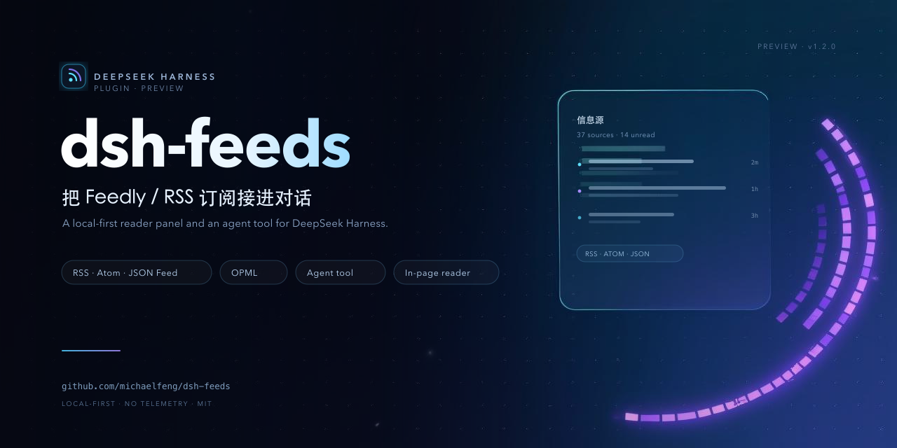
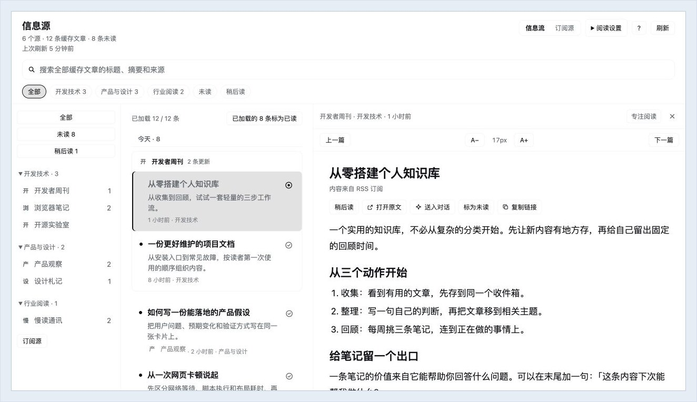
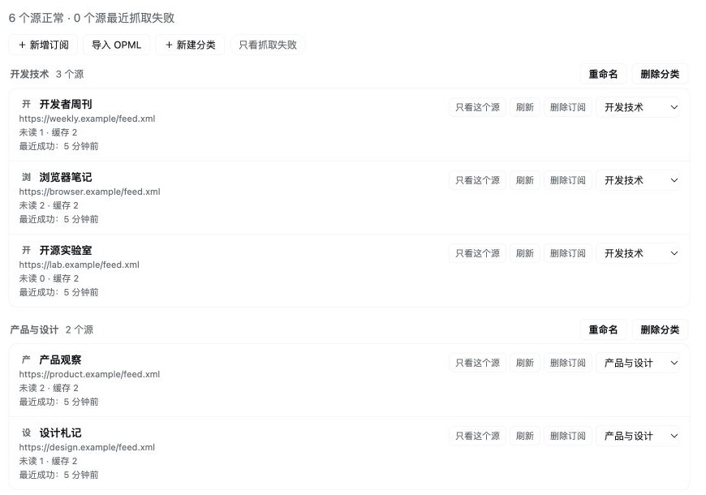
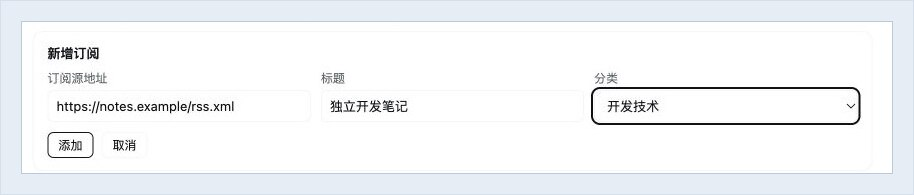
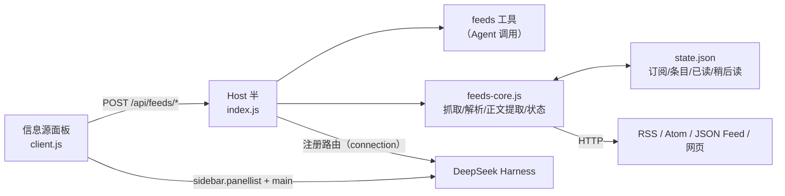

# dsh-feeds

[](https://github.com/michaelfeng/dsh-feeds/actions/workflows/ci.yml)
[](LICENSE)
[](https://github.com/deepseek-ai/deepseek-harness)
[](CHANGELOG.md)

把 Feedly / RSS 订阅接进 [DeepSeek Harness](https://github.com/deepseek-ai/deepseek-harness)：左侧边栏多一个
**「信息源」全局面板**，模型也获得一个 `feeds` 工具，可以直接回答「我的订阅今天有什么新内容」。

> **状态：Preview（源码预览版）。** 适配 DeepSeek Harness `0.2.2-rc.1` 的 Desktop / Web GUI，
> 在 macOS 上实机验证；Windows / Linux 未实机验证。尚未发布 npm 包。



Feedly 只是导入来源之一：任何标准 OPML、任意 RSS/Atom/JSON Feed 地址、以及声明了 feed 链接的网站都可以订阅。

## 界面截图

以下截图使用演示订阅和示例文章。

**三栏阅读。** 左侧按分类和订阅源筛选，中间按来源折叠同一天的更新，右侧在页内阅读正文并调整字号。



**管理订阅。** 查看抓取状态、移动订阅源的分类，或导入 OPML。



**新增订阅。** 粘贴网站或 Feed 地址，可选填标题和分类。



## 功能

- **订阅来源**：Feedly OPML 或任意标准 OPML 导入；对话/界面新增单个 RSS；网页声明 feed 链接时可直接添加网站地址
- **订阅管理**：界面内新增订阅（URL/标题/分类，可现场新建分类）、重命名/删除分类（非空分类删除时选择源的去向）、把源移动到其他分类、OPML 导入可选**合并/替换**（替换需确认）
- **阅读**：三栏阅读器（来源导航 / 文章列表 / 正文），页内阅读 + 专注模式；RSS 全文优先，网页正文提取（保留图片、代码、表格，过滤导航/评论/分享）；字号可调
- **整理**：分类 / 来源 / 未读 / 稍后读筛选，全文搜索，批量已读 + 撤销，快捷键，筛选与阅读位置记忆
- **和模型打通**：`feeds` 工具供 Agent 查询/摘要/读正文；文章面板「用 DSH 总结」把提问插入输入框（不自动发送）
- **本地优先**：订阅、已读、稍后读都存在本机，无遥测

## 支持的订阅格式

| 类型 | 支持 |
| --- | --- |
| RSS 2.0 | ✅ |
| Atom 1.0（含 `type="xhtml"`） | ✅ |
| RSS 1.0 / RDF | ✅ |
| JSON Feed | ✅ |
| OPML 导入（Feedly / 任意标准 OPML） | ✅ 合并或替换，保留仍存在订阅的已读记录 |
| 网页自动发现（`<link rel="alternate" ...rss+xml>` 等） | ✅ 可在对话中直接添加网站地址 |
| 需要 Cookie / 登录 / 自定义请求头的私有源 | ❌ 暂不支持 |
| 回写 Feedly 已读状态 | ❌ 需要 Feedly Pro API，当前不接 |

## 安装

前置：DeepSeek Harness（profile bundle 机制，Desktop 或 Web GUI）。仅开发/测试需要 Node.js 22+。

```bash
git clone https://github.com/michaelfeng/dsh-feeds.git
```

然后在 DSH 里让 Agent 执行（把路径换成你的克隆目录）：

```text
plugin_manager install_bundle /absolute/path/to/dsh-feeds
```

安装后刷新 Web 页面，左侧边栏会出现 **「信息源」** 入口（与 Plugins / Automation tasks 同一组，排在
Automation tasks 之后、More 之前）。它是一个**用户级全局面板**，不属于任何会话，切换/新建会话不会影响
订阅浏览。

- **升级**：`plugin_manager remove_bundle dsh-feeds`，再重新 `install_bundle <本机路径>`。
- **卸载**：`plugin_manager remove_bundle dsh-feeds`。订阅数据保留在 `dataDir`，可自行删除。

## 快速开始

1. 在 Feedly 导出 OPML：<https://feedly.com/i/opml>（或 Settings → Import/Export）。
2. 在 DSH 对话里说：`帮我导入 ~/Downloads/feedly-xxx.opml`；或在「信息源 → 订阅源 → 导入 OPML」里填路径选择合并/替换。
3. 新增单个来源：界面「＋ 新增订阅」，或对话 `帮我订阅 https://example.com/feed.xml，放到「研究」分类`。
4. 点左侧边栏「信息源」→ 信息流 / 订阅源，按分类、来源、未读、稍后读浏览；点条目在右侧读正文。

## 工具 `feeds`

| action | 参数 | 说明 |
| --- | --- | --- |
| `digest` | `sinceHours`(默认 24)、`limit`(默认 60)、`category`、`feedId`、`unreadOnly` | 最新条目，按时间倒序 |
| `sources` | — | 分类/订阅/未读数/抓取错误 |
| `refresh` | `feedId?` | 立即抓取（最长等待 45s，之后后台继续） |
| `article` | `itemId` | 读取单条正文（RSS 全文优先，失败回退网页提取/摘要） |
| `import` | `path`、`mode?`(replace/merge) | 导入 OPML：合并或替换整个列表 |
| `add` | `url`、`title?`、`category?` | 新增一个订阅，并报告首次抓取结果 |
| `update` | `feedId`、`title?`、`category?` | 重命名订阅 / 移动到其他分类（分类不存在时自动创建） |
| `category` | `op`(create/rename/delete)、`name`、`newName?`、`moveTo?` | 新建 / 重命名（同名合并）/ 删除分类（非空需指定移动目标） |
| `mark` | `itemIds` / `category` / `feedId`、`read` | 设置已读/未读 |
| `remove` | `feedId` | 取消订阅 |

## 界面操作

- **页内阅读**：点条目在右侧面板读正文，不跳浏览器；可打开原文、用 DSH 总结、切换已读/稍后读、复制链接、调字号，或切「专注阅读」让正文占满。
- **快捷键**：`j`/`k` 上下选择，`Enter` 打开原文，`m` 切换已读，`/` 搜索，`r` 刷新，`Esc` 关闭阅读面板。
- **筛选与批量**：分类 chip、点源名只看该源、未读/稍后读过滤、当前列表「全部标为已读」（可撤销）、清除全部筛选。
- **订阅源面板**：按分类列出所有源，支持只看某源、单源刷新、删除订阅、只看抓取失败；支持界面内 **＋新增订阅**、**导入 OPML（合并/替换）**、**新建/重命名/删除分类**、**把源移动到其他分类**。
- 筛选状态（分类/未读/来源/稍后读）与阅读位置会记住；顶栏显示上次刷新时间。

## 架构



- **Host**（`index.js` + `feeds-core.js`）：订阅与状态、抓取解析、正文提取、`feeds` 工具、11 条 `/api/feeds/*` RPC。
- **Client**（`client.js`）：左侧边栏全局面板，注册 `sidebar.panellist` 行与 `main` 面板；纯浏览器模块，不自行抓取 feed。
- 契约见 [CONTRACT.md](CONTRACT.md)；安全模型见 [SECURITY.md](SECURITY.md)。

## 配置

`cordis.patch.yml` 中的一行：

```yaml
- id: feeds
  config:
    dataDir: !!js dshHomePath('feeds')   # 状态目录（state.json）
    refreshMinutes: 30                    # 快照过期后自动后台刷新
    # allowPrivateHosts: true             # 默认 false：拒绝解析到内网/环回地址的源与正文，内网 RSS 需显式开启
```

## 数据与隐私

- 状态文件：`~/.dsh/feeds/state.json`（订阅、缓存条目、已读、稍后读；不含凭据）。
- 诊断文件：`~/.dsh/feeds/last-boot.json`（插件激活时的 connection 状态与注册路由数）。
- 正文抓取只请求订阅条目中的链接，不携带你的凭据；拒绝非 `http(s)` 与私有/环回地址。
- 阅读图片由浏览器直接向源站加载（不发送 Referer）。
- 无遥测、无第三方服务、无外部账号。

## 故障排查

- **视图显示 “Feeds are unavailable”**：页面拿不到 Host 的 `/api/feeds/*` 路由。先点错误卡片的「重试」或刷新页面；仍失败时重启 DSH。
- 诊断文件正常应为 `{"connection":true,"routes":11}`；若是 `connection:false`，说明插件在 Host connection 之前激活。
- **部分源抓取失败**：404/403/521/超时等通常是源站关停、改版或访问限制；抓取失败不会清空已缓存条目，可在订阅源面板重试。
- **图片不显示**：源站防盗链时阅读面板会显示「图片加载失败 · 打开图片」。

## 开发

```bash
npm run check      # node --check 三个运行文件
npm test           # 119 项离线回归（node:test，不访问网络）
npm run benchmark  # 查询/传输基准（合成数据）
```

CI：`.github/workflows/ci.yml` 在 Node 22 / 24 上跑 `check` + `test`。

```
index.js         Host 半：feeds 工具 + /api/feeds/* 路由 + 启动/刷新调度
feeds-core.js    订阅/OPML/feed 解析、正文提取、状态存储（可独立 node 测试）
client.js        Client 半：左侧边栏「信息源」面板
locale/          中英文文案（含插件管理页标题/描述）
tests/           离线测试（core / host / article / client / management / tool-schema）
tools/           手动冒烟（test-core）与基准（benchmark）
docs/images/     README 截图
CONTRACT.md      Host ↔ Client RPC 契约
SECURITY.md      安全模型与漏洞上报
CONTRIBUTING.md  开发与 PR 指南
```

## 参与贡献

欢迎 issue / PR，请先阅读 [CONTRIBUTING.md](CONTRIBUTING.md)。安全问题请按 [SECURITY.md](SECURITY.md) 私下报告。

## 许可证

[MIT](LICENSE)。本项目为社区插件，与 Feedly、DeepSeek 官方无隶属关系。

## 路线图（1.0 之前）

- npm 发布所需的命名/`private` 调整与安装矩阵（Windows / Linux / 干净 profile）
- 需要认证的私有源（Cookie / 自定义请求头）
- 更多界面语言
- 可选 Feedly API 双向已读同步
