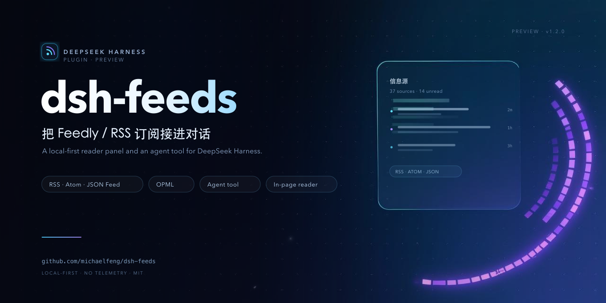

# Marketing assets



## Files

| File | Purpose |
| --- | --- |
| `social-preview.png` | 1280×640 GitHub **Social preview** (Settings → General → Social preview). Also used as the README hero. |
| `poster.svg` | Editable composition (background image + typography/layout). |
| `background.jpg` | AI-generated background used by `poster.svg`. |

## How it was made

- Background: generated with **即梦（Jimeng）图生图 3.0 智能参考** (`jimeng_i2i_v30`, Volcengine Visual API)
  from a simple gradient base, prompting for a dark developer-tool key visual with pixel RSS arcs,
  frosted glass panel, particles and left-side negative space. No text or logos were generated by the model.
- Typography, brand mark, pills and the stylised "信息源" panel: hand-composed in `poster.svg` for crisp
  text at every size. The panel is an **illustration**, not a screenshot, and contains no real data.
- Rendered with `rsvg-convert`:

```bash
cd docs/marketing
rsvg-convert -w 1280 -h 640 poster.svg -o social-preview.png
```

## Replacing it

Edit `poster.svg` and re-render, then update `social-preview.png`. To regenerate the background, call the
Jimeng i2i API with your own Volcengine credentials kept in environment variables — **never commit keys**
to this repository.

## License

The composition and brand artwork in this directory are part of the project and covered by the repository
[MIT license](../../LICENSE). The AI-generated background was produced for this project via Volcengine
Jimeng; review your provider's terms before reusing it elsewhere.
